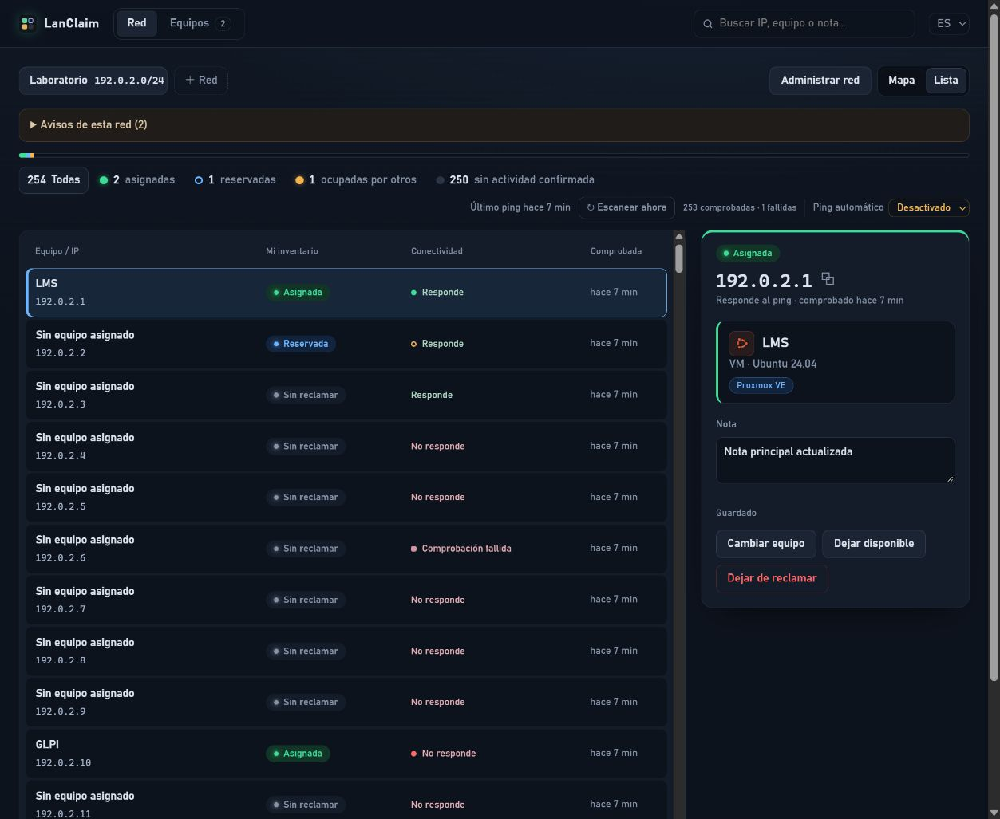
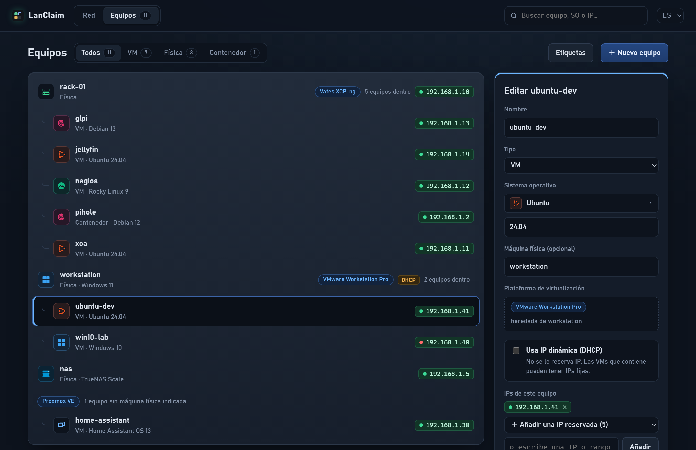

# LanClaim

[English](README.md) · **Español**

**Tu inventario personal de IPs.** Mira cada dirección de tu red en un mapa o una lista, reclama las que quieras y lleva la cuenta de qué equipo usa cada una: máquinas físicas, VMs y contenedores. Autoalojado, con interfaz oscura en español e inglés.

LanClaim es un inventario, no un servidor DHCP: reclamar una IP la registra como tuya. No la reserva en el router.





*Capturas con datos de ejemplo.*

## Cómo funciona

Cada dirección está en uno de cuatro estados:

| Estado | Significado |
| --- | --- |
| **Asignada** (verde) | Tuya y en uso por un equipo, como `glpi` o `nas`. |
| **Reservada** (contorno azul) | Tuya, esperando la próxima instalación. |
| **Ocupada por otro** (ámbar) | No es tuya, pero responde al ping. |
| **Sin actividad confirmada** (gris) | No es tuya y no hay una respuesta positiva vigente. Puede estar sin comprobar o tener datos antiguos o fallidos. |

### Red

Cada red registrada (de `/22` a `/30`) ofrece **Mapa / Lista**, con la misma selección y panel. La lista muestra nombre, IP completa, inventario, conectividad y última comprobación.

- Haz clic en una celda para reclamarla, asignarla a un equipo (si escribes un nombre nuevo, el equipo se crea), cambiar o quitar su equipo, añadir una nota o liberarla.
- Shift+clic o arrastrar selecciona varias celdas a la vez. En pantallas táctiles, usa **Seleccionar varias**.
- **Administrar red** permite cambiar nombre y segmento CIDR o quitar la red. Conserva tus IPs, equipos y notas; las IPs fuera del segmento aparecen en **Otras**.
- Los contadores funcionan como filtros. **Todas**, activa por defecto, quita el filtro de estado con un clic. El buscador resalta las celdas por IP, equipo o nota.
- Las IPs reclamadas fuera de toda red registrada aparecen en **Otras**.
- **Dejar disponible** quita la asignación y conserva la IP y su nota. **Dejar de reclamar** elimina la IP del inventario y su nota.
- Los borradores de equipos, redes, asignaciones y notas sobreviven a navegar y recargar dentro de la pestaña. Las ediciones concurrentes piden revisar la versión del servidor antes de sobrescribirla.

### Equipos

Los equipos aparecen debajo de la máquina física donde corren. Las VMs sin máquina se agrupan por plataforma. El formulario se abre en un panel lateral, así que la lista nunca salta.

- **Sistema operativo:** se elige de una biblioteca de iconos planos (Windows, Ubuntu, Debian, Rocky Linux, AlmaLinux, CentOS, Red Hat, Fedora, Alpine, Arch, openSUSE, FreeBSD, TrueNAS, Proxmox VE, macOS, otro Linux, otro sistema) y solo escribes la versión. Los iconos se dibujan en la propia app, sin descargas.
- **Máquina física y plataforma:** una VM o contenedor puede correr en una máquina física y en una plataforma de virtualización (Vates XCP-ng, VMware Workstation Pro, tus propias etiquetas…). Dentro de una máquina con plataforma, la VM la hereda. Si eliges una plataforma que solo ejecuta una máquina, la máquina se rellena sola.
- **IP dinámica (DHCP):** un equipo puede marcarse como DHCP. No se le reserva IP, y las VMs que contiene conservan sus IPs fijas.
- **IPs:** quita una (vuelve a reservada), añade una de tus IPs reservadas o escribe una IP nueva, que se reclama al guardar. Al eliminar un equipo, sus IPs quedan reservadas.
- **Etiquetas:** tus plataformas y sistemas operativos con cuántos equipos usan cada uno. Renombra uno en todos los equipos a la vez o quita los que nadie usa.

### Ping automático

El servidor hace ping a todas las direcciones vigiladas según un ciclo, y enseguida al añadir una red. También puedes pulsar **Escanear ahora**.

- En la vista Red, **Ping automático** lo desactiva o fija el ciclo, de cada minuto a una vez al día. La elección se guarda en el servidor y se aplica al momento. `LANCLAIM_SCAN_INTERVAL` (segundos, 300 por defecto) solo es el valor inicial mientras no elijas otro.
- En cada puerto, un punto verde indica que el equipo responde y uno rojo que no. Un anillo ámbar marca una IP libre que respondió en los últimos 7 días, probablemente un equipo apagado.
- **Avisos de esta red** muestra reservadas que responden y comprobaciones fallidas. Se distinguen respuestas, ausencia de respuesta, direcciones sin comprobar y datos antiguos. La interfaz avisa si pierde conexión.
- El ping nunca cambia lo que es tuyo. Un firewall puede bloquear ICMP, así que una IP que no responde no tiene por qué estar libre.

No tiene dependencias de paquetes de Python. Los datos se guardan en SQLite.

## Ejecutar en local

Requiere Python 3.10 o superior:

```bash
python3 -m lanclaim.server
```

Abre [http://127.0.0.1:8080](http://127.0.0.1:8080). En Windows usa `python`. Los datos se guardan en `./data/lanclaim.sqlite3`. Opciones útiles: `--data-dir`, `--port` y `--scan-interval`. Para abrir la interfaz en un idioma concreto, añade `?lang=es` o `?lang=en` a la URL.

## Instalar en Linux

Requiere systemd, Bash y acceso root. El instalador prepara Python, `iproute2` y `ping` con el gestor de paquetes del sistema.

```bash
chmod +x install.sh update.sh uninstall.sh
sudo ./install.sh
```

El servicio escucha en el puerto 8080 (`sudo env LANCLAIM_PORT=8090 ./install.sh` elige otro). Se ejecuta como el usuario `lanclaim` con `NoNewPrivileges` y solo `CAP_NET_RAW`, así que el ping funciona sin cambiar ajustes globales. No se modifican reglas del firewall.

```bash
# Actualizar desde tu copia (hace una copia de la base y vuelve atrás si la nueva versión no arranca):
git pull --ff-only
sudo ./update.sh

# Quitar la aplicación conservando datos y configuración:
sudo ./uninstall.sh

# Quitar todo, incluidos datos y copias:
sudo ./uninstall.sh --purge
```

Las actualizaciones dentro de la versión 2 conservan tu inventario: los cambios de la base se migran al arrancar.

> **Desde la versión 0.x:** la versión 2 empieza con el inventario vacío. La base anterior se descarta en el primer arranque; la copia que hace `update.sh` queda en `/var/lib/lanclaim/backups`.

Es una herramienta de un solo usuario sin autenticación, pensada para una red privada de confianza. Para cualquier otro acceso, ponla detrás de un proxy HTTPS con autenticación o de una VPN. Configura `LANCLAIM_ALLOWED_HOSTS` si usas un nombre de host propio. Consulta la [guía de operación](docs/OPERACION.md).

## Validación

```bash
python3 -m unittest discover -s tests -v
node tests/test_model.mjs
node tests/test_i18n.mjs
node tests/test_autosave.mjs
node tests/test_drafts.mjs
node tests/test_api.mjs
bash -n install.sh update.sh uninstall.sh scripts/common.sh

# Entorno Linux de integración desechable; no cambia servicios del equipo:
docker build -f tests/linux/Dockerfile -t lanclaim-lifecycle:test .
docker run --rm lanclaim-lifecycle:test
```

## Documentación

- [Operación, instalación y recuperación](docs/OPERACION.md)
- [Modelo de datos](docs/MODELO.md)
- [Verificaciones y límites](docs/VERIFICACION.md)
