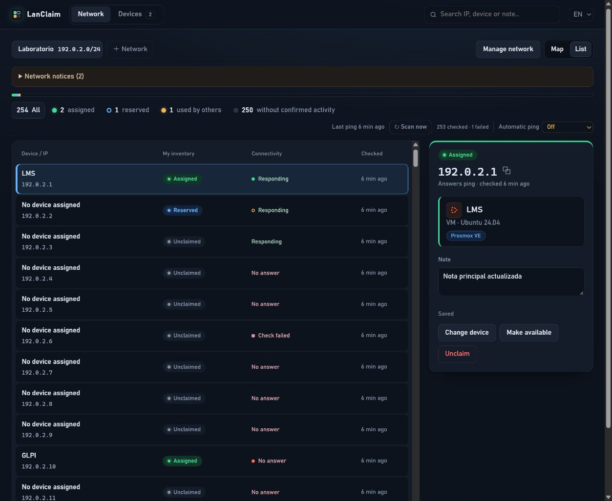
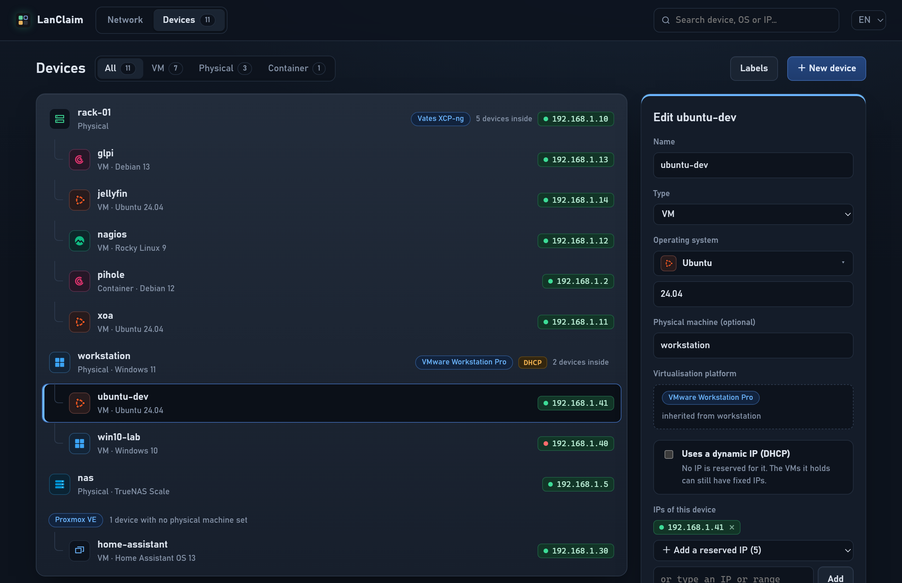

# LanClaim

**English** · [Español](README.es.md)

**Your personal IP inventory.** See every address of your network on a map, claim the ones you want and keep track of which device uses each of them: physical machines, VMs and containers. Self-hosted, with a dark interface in Spanish and English.

LanClaim is an inventory, not a DHCP server: claiming an IP records it as yours. It does not reserve it on a router.





*Screenshots with example data.*

## How it works

Every address is in one of four states:

| State | Meaning |
| --- | --- |
| **Assigned** (green) | Yours, used by a device such as `glpi` or `nas`. |
| **Reserved** (blue outline) | Yours, waiting for the next install. |
| **Used by someone else** (amber) | Not yours, but it answers ping. |
| **Free** (grey) | Not yours and silent. A fainter cell means it has never been pinged. |

### Network

Each registered network (`/22` to `/30`) is shown as a grid of ports, with a bar summarising how much of it is in use.

- Click a cell to claim it, assign it to a device (typing a new name creates the device), change or remove its device, add a note or release it.
- Shift+click or drag to select several cells at once. On touch screens, use **Select several**.
- **I need an IP** jumps to your first reserved address, or to the first free one nobody answered from in the last 7 days.
- The counters work as filters. **All**, selected by default, clears the status filter with one click. The search box highlights cells by IP, device or note.
- IPs you claimed outside every registered network are listed under **Other**.

### Devices

Devices are listed under the physical machine they run on. VMs without a machine are grouped by platform. The form opens in a side panel, so the list never jumps.

- **Operating system:** picked from a library of flat icons (Windows, Ubuntu, Debian, Rocky Linux, AlmaLinux, CentOS, Red Hat, Fedora, Alpine, Arch, openSUSE, FreeBSD, TrueNAS, Proxmox VE, macOS, other Linux, other system). You type only the version. The icons are drawn in the app, with no downloads.
- **Physical machine and platform:** a VM or container can run on a physical machine and on a virtualisation platform (Vates XCP-ng, VMware Workstation Pro, your own labels…). Inside a machine that has a platform, the VM inherits it. Picking a platform that only one machine runs fills in the machine.
- **Dynamic IP (DHCP):** a device can be marked as DHCP. No IP is reserved for it, while the VMs it holds keep their fixed IPs.
- **IPs:** remove one (it goes back to reserved), add one of your reserved IPs, or type a new IP, which is claimed on save. Deleting a device keeps its IPs as reserved.
- **Labels:** your platforms and operating systems with how many devices use each one. Rename one everywhere at once, or remove the ones nobody uses.

### Automatic ping

The server pings every watched address on a cycle, and right away when you add a network. You can also press **Scan now**.

- In the Network view, **Automatic ping** turns it off or sets the cycle, from every minute to once a day. The choice is saved on the server and applied at once. `LANCLAIM_SCAN_INTERVAL` (seconds, default 300) is only the starting value until you pick one.
- On each port, a green dot means the device answers and a red dot means it does not. An amber ring marks a free IP that answered in the last 7 days, probably a device that is switched off.
- Ping never changes what is yours. A firewall may block ICMP, so a silent IP is not proof that it is free.

There are no Python package dependencies. Data lives in SQLite.

## Run locally

Requires Python 3.10+:

```bash
python3 -m lanclaim.server
```

Open [http://127.0.0.1:8080](http://127.0.0.1:8080). On Windows use `python`. Data is stored in `./data/lanclaim.sqlite3`. Useful options: `--data-dir`, `--port` and `--scan-interval`. To open the interface in a given language, add `?lang=en` or `?lang=es` to the URL.

## Install on Linux

Requires systemd, Bash and root access. The installer prepares Python, `iproute2` and `ping` with the system package manager.

```bash
chmod +x install.sh update.sh uninstall.sh
sudo ./install.sh
```

The service listens on port 8080 (`sudo env LANCLAIM_PORT=8090 ./install.sh` picks another one). It runs as the `lanclaim` user with `NoNewPrivileges` and only `CAP_NET_RAW`, so ping works without changing global settings. No firewall rules are changed.

```bash
# Update from your checkout (makes a database backup and rolls back if the new version fails to start):
git pull --ff-only
sudo ./update.sh

# Remove the app, keep data and configuration:
sudo ./uninstall.sh

# Remove everything, including data and backups:
sudo ./uninstall.sh --purge
```

Updates within version 2 keep your inventory: database changes are migrated on start.

> **Upgrading from 0.x:** version 2 starts with an empty inventory. The previous database is discarded on first start; the copy made by `update.sh` stays in `/var/lib/lanclaim/backups`.

This is a single-user tool without authentication, meant for a trusted private network. For any other access, put it behind an authenticated HTTPS reverse proxy or a VPN. Set `LANCLAIM_ALLOWED_HOSTS` when using a custom hostname. See the [operations guide](docs/OPERACION.md).

## Validation

```bash
python3 -m unittest discover -s tests -v
node tests/test_model.mjs
node tests/test_i18n.mjs
node tests/test_autosave.mjs
bash -n install.sh update.sh uninstall.sh scripts/common.sh

# Disposable Linux integration environment; no host service changes:
docker build -f tests/linux/Dockerfile -t lanclaim-lifecycle:test .
docker run --rm lanclaim-lifecycle:test
```

## Documentation / Documentación

- [Operación, instalación y recuperación](docs/OPERACION.md)
- [Modelo de datos](docs/MODELO.md)
- [Verificaciones y límites](docs/VERIFICACION.md)
